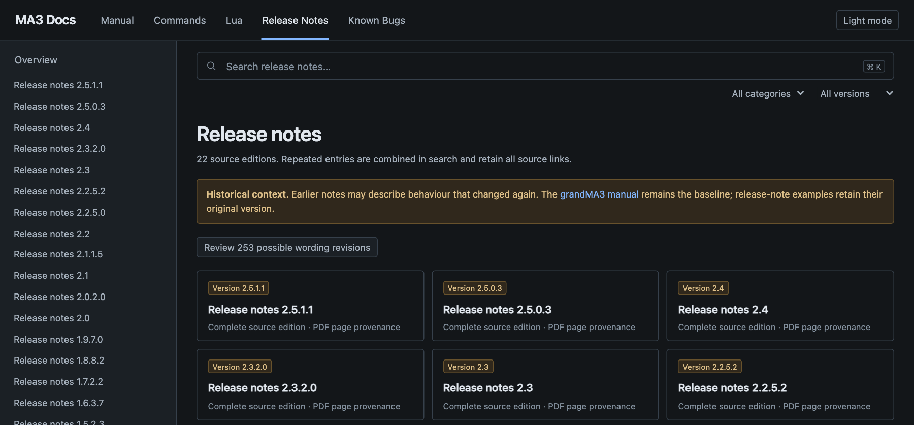
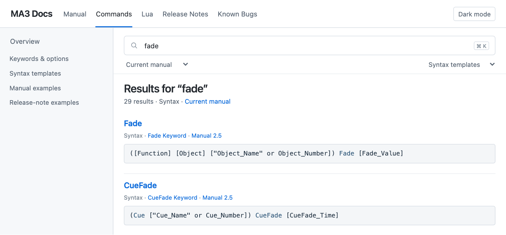
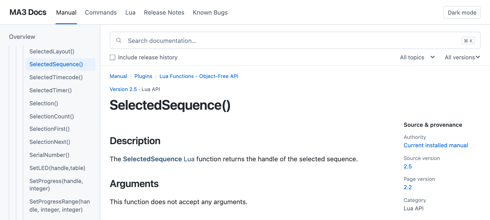

# MA3 Reference

<a name="screenshots"></a>

[](screenshots/releases.png)

<p>
  <a href="screenshots/commands.png"></a>
  <a href="screenshots/topic.png"></a>
</p>

The screenshots show 22 release-note editions, a command search for `fade`, and the `SelectedSequence()` Lua reference. [Source credits](NOTICE.md)

MA3 Reference searches the grandMA3 manual and release notes you import on your own computer. Search results link to their source topic or PDF page and identify the software version.

## Get started

Use Python 3.10 or later with SQLite FTS5. From the repository directory, start the viewer and open [127.0.0.1:8765](http://127.0.0.1:8765).

```sh
python3 scripts/serve.py --port 8765
```

A new checkout opens with an empty index. Stop the viewer with Ctrl+C before importing a publication.

## Get the source files

| Source | Where to obtain it | Where to put it |
| --- | --- | --- |
| English HTML manual | Install the grandMA3 onPC software for your platform from MA Lighting. Use the installed `shared/language` directory. It contains `HTML/`, `_webHelpScripts/` and supporting assets. [Official software downloads](https://www.malighting.com/downloads/products/grandma3/) | Copy the whole `language` directory to `sources/manual/` so that `sources/manual/HTML/` exists, or set `MA3_MANUAL_SOURCE` to the existing `language` directory. The manual importer takes the HTML publication. |
| Release notes | On the same official download page, choose **Software + Release Notes**, expand the version and download its English **grandMA3 Release Notes** PDF. Older versions are under **Archive**. [Official release notes](https://www.malighting.com/downloads/products/grandma3/) | Create `release-notes-pdf/` in the repository. Place each original PDF directly inside it, using a distinct filename ending in `.pdf`. |

You can import either source independently. With both present, the release importer can use the manual's keyword list to recognize more command examples. The HTML importer has been tested with the 2.5 publication bundled with grandMA3 onPC 2.5.1.1. The official manual can also be read online. [MA Lighting online manual](https://help.malighting.com/grandMA3/2.5/HTML/help.html)

## Build the local index

Use a virtual environment for the import libraries. For PDF import, install Poppler and make sure `pdftotext` is available on your PATH. On macOS the Homebrew package is `poppler`. On Debian and Ubuntu the package is `poppler-utils`.

```sh
python3 -m venv .venv
. .venv/bin/activate
python -m pip install lxml 'pypdf[image]' pdfplumber
mkdir -p sources release-notes-pdf
```

When the source files are in place, import them and start the viewer. The commands below use a POSIX shell. If you use the installed manual in place, set `MA3_MANUAL_SOURCE` before the import.

```sh
# Optional on macOS, for a 2.5.1 installation
export MA3_MANUAL_SOURCE="$HOME/MALightingTechnology/gma3_2.5.1/shared/language"

sh scripts/build_all.sh
python scripts/serve.py --port 8765
```

If you copied the manual to `sources/manual/`, omit the `export` line. Set `MA3_MANUAL_VERSION` to the publication's major/minor label when importing a version other than 2.5. The importer runs locally and reads only the supplied files. Re-run it when adding or updating sources. The local API is documented in the [API guide](app/README.md).

## Optional local Lua capture

The Lua view uses the Lua reference topics from the imported manual. If you also have a compatible grandMA3 MCP bridge running locally, you can optionally index API descriptors from your console. Import the manual first. With the bridge already running, `python3 scripts/capture_lua_api.py` captures the descriptors and `python3 scripts/build_index.py` adds them to search. Use `--help` for port, HelpLua export and token-scan options. Keep captured console records and exports local together with the source publications.

## Local files

| Path | Contents |
| --- | --- |
| `sources/manual/`, `release-notes-pdf/` | Your source publications |
| `content/`, `assets/`, `data/` | Generated text, illustrations, source records and navigation |
| `.cache/catalog.sqlite` | Search database derived from the local records |

These directories belong on your computer. Keep them out of Git and out of public builds, including caches, image archives and search indexes.

## Copyright

The grandMA3 manual, release notes, illustrations and other MA Lighting material are copyright MA Lighting and their respective rights holders. The repository distributes the independent viewer and import tools. It provides no licence to redistribute the publications or their converted contents. [Copyright notice](NOTICE.md) · [MA Lighting legal notice](https://www.malighting.com/imprint/)
